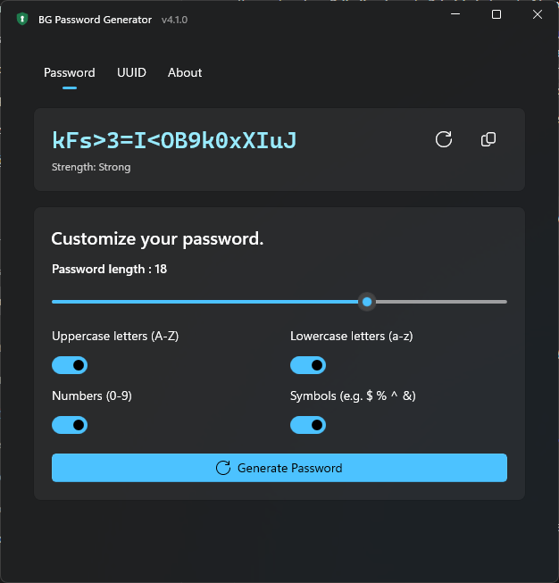

# BG Password Generator 👋
#### It is designed for personal use.

A native Windows app for quickly creating passwords and random UUIDs, and for hashing or Base64-encoding text. It works offline and does not require internet. Generated passwords are never stored anywhere and/or sent to a remote location.

- Passwords are generated with a cryptographically secure random number generator, contain every selected character type and are shuffled.
- Copied passwords are kept out of Windows clipboard history (Win+V) and cloud clipboard sync, and are cleared after 30 seconds or when the window closes, unless something else was copied since.
- Random UUIDs (version 4), optionally uppercase or without hyphens. UUIDs are copied normally since they aren't secrets.
- MD5, SHA-1, SHA-256 and SHA-512 hashes and Base64 encoding of text, as you type. Results are copied the same guarded way as passwords. MD5 and SHA-1 are broken and only suit checksums, and Base64 isn't encryption.
- Updates from GitHub: on startup an installed copy checks this repository's latest release and offers to update and restart. The update check is the app's only network request; it sends nothing but the request itself, and the app works normally when offline. The About page shows the version, project links and a manual "Check for updates" button.

See [PRIVACY.md](PRIVACY.md) for exactly what the app does with your data, the clipboard and the network.

## Tech


WinUI 3 (Windows App SDK) on .NET 10.

- `src/BgPasswordGenerator.Core` — password and UUID generation, strength rules, hashing and Base64 (plain .NET, no UI)
- `src/BgPasswordGenerator` — WinUI 3 app, unpackaged and self-contained
- `tests/BgPasswordGenerator.Tests` — xUnit tests for the core library

## Installation

Requires the [.NET 10 SDK](https://dotnet.microsoft.com/download).

```sh
git clone https://github.com/berkguclukol/bg-password-generator.git
cd bg-password-generator
dotnet test
dotnet run --project src/BgPasswordGenerator
```

## Packaging

Setup and portable packages are built with [Velopack](https://velopack.io). Install its CLI once, matching the `Velopack` package version in the app project:

```sh
dotnet tool install -g vpk --version 1.2.158
```

Then run the build script, which tests, publishes and packages the app:

```powershell
./build.ps1                                   # win-x64
./build.ps1 -Runtimes win-x64, win-x86, win-arm64
```

Output in `Releases/<runtime>/`:

- `BgPasswordGenerator-<runtime>-Setup.exe` — per-user install (no admin), with Desktop and Start Menu shortcuts and an uninstall entry in Apps & features
- `BgPasswordGenerator-<runtime>-Portable.zip` — extract anywhere and run `BG Password Generator.exe`

Both are self-contained and run without installing .NET or the Windows App Runtime. The release version comes from `<Version>` in `src/BgPasswordGenerator/BgPasswordGenerator.csproj`.

### Publishing a release

Bump `<Version>`, write the release notes to a file and run:

```powershell
./build.ps1 -Runtimes win-x64, win-x86, win-arm64 -Publish -NotesFile notes.md
```

This needs the [GitHub CLI](https://cli.github.com) signed in. It creates a GitHub release named after the version with the installers plus the update files (`releases.<runtime>.json` and `.nupkg` packages) that installed copies use to update themselves. Keep the `Releases/` folder between versions so vpk can build small delta updates from the previous package.

## Screen Shot



## License

MIT
