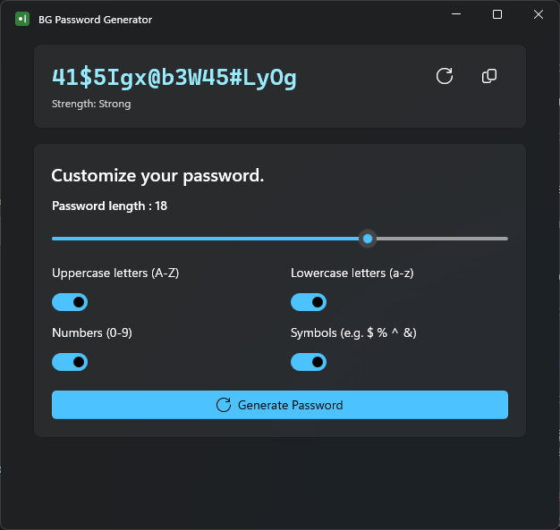

# BG Password Generator 👋
#### It is designed for personal use.

A native Windows app for quickly creating passwords. The application works offline and does not require internet. Generated passwords are never stored anywhere and/or sent to a remote location.

- Passwords are generated with a cryptographically secure random number generator, contain every selected character type and are shuffled.
- Copied passwords are kept out of Windows clipboard history (Win+V) and cloud clipboard sync, and are cleared after 30 seconds or when the window closes, unless something else was copied since.

## Tech


WinUI 3 (Windows App SDK) on .NET 10.

- `src/BgPasswordGenerator.Core` — password generation and strength rules (plain .NET, no UI)
- `src/BgPasswordGenerator` — WinUI 3 app, unpackaged and self-contained
- `tests/BgPasswordGenerator.Tests` — xUnit tests for the core library

## Installation

Requires the [.NET 10 SDK](https://dotnet.microsoft.com/download).

```sh
git clone https://github.com/berkguclukol/bg-password-generator.git
cd bg-password-generator
dotnet test
dotnet run --project src/BgPasswordGenerator
```

To create a package:

```sh
dotnet publish src/BgPasswordGenerator -c Release -r win-x64 -o publish
```

The `publish` folder is self-contained and runs without installing .NET or the Windows App Runtime.

## Screen Shot



## License

MIT
